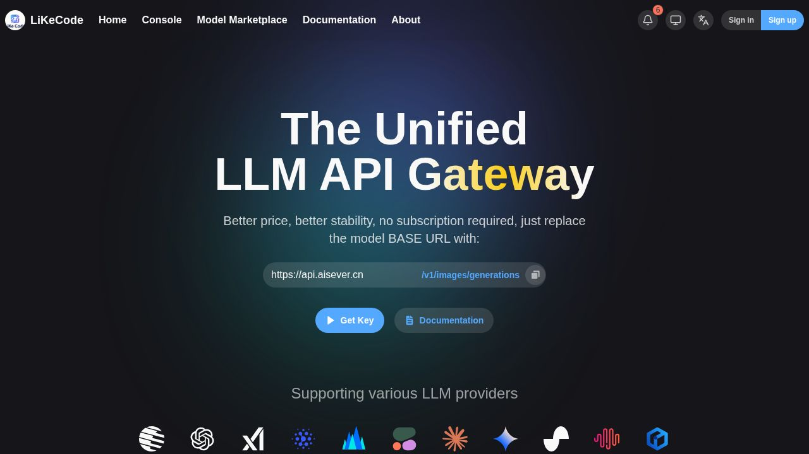
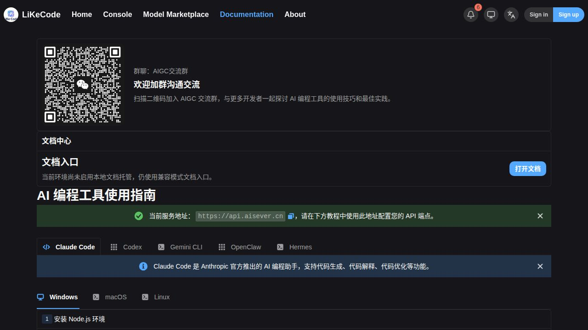

# ba844d202 生产发布结果（2026-10-19）

用户已明确批准本次生产发布。新版本于北京时间 **2026-10-19 00:07:10** 恢复公网流量；最终观察回执见本页下方和 evidence/production-final.json。

## 发布产物与现场配置

| 项目 | 结果 |
|---|---|
| 分支 | `codex/security-v0.13.2-p1-20261018` |
| 应用源码 | `ba844d202b683219dadc679af3521dc1d8abde9f` |
| 不可变镜像 | `sha256:d07e5682b016202338524f832d8206f2d99ac4b916a1391db92100cdfb9405e1` |
| 镜像标签 | `new-api:security-ba844d202` |
| 运行版本 | `codex/sec-v0.13.2-p1+ba844d202+production` |
| 当前容器 | `new-api-local`，`1eb9ca593176302c310e0471489dcb052cfebb9bac3778becf69e50a50003ea3` |
| 原容器 | `986a046e81792121a47f7ccce7e1e7179c36217a8c08620c3fbacf788d3b9e79`，保留为 `new-api-local-rollback-security-20261018`，停止且 restart=no |
| 原镜像 | `sha256:13a6bcdccd8424b3e6c962d3f072f2cdc14158e07b256f34dcd4650f790455d7` |
| 数据与日志挂载 | `/opt/new-api/data:/data`、`/opt/new-api/logs:/app/logs` |

同一已验证镜像直接上线，没有重新构建。Env 除 VERSION 外逐项完全相同，包括 SESSION_SECRET、CRYPTO_SECRET、SQL_DSN、REDIS_CONN_STRING、TZ 和缓存/批处理开关。完整 HostConfig 对比无差异；完整 Config 只有 Image、Env、Labels 三项变化。Labels 是新镜像自动继承的 OCI 来源信息，原自定义标签保留。镜像内 OCI 构建版本仍为 test，这是不可变测试产物的来源记录；实际运行 VERSION 为 production。

数据库、Redis、Caddy 和原有 new-api-test 保持原容器 ID、镜像、启动时间及重启计数。短暂维护窗口通过 Caddy 运行时路由及专属防火墙规则排空流量；最终恢复原始路由，Caddyfile 摘要未变，专属维护规则已移除。未改 DNS、代理节点或线上定价配置。

## 备份已恢复验证

服务器备份目录：`/opt/new-api-backups/security-20261018-233325/`，权限 0700。含数据库、角色、Docker 原始参数、挂载数据/日志、Caddy 配置、原镜像及 SHA-256 清单。所有含密钥的原始资料只保存在私有目录。

- 初始一致性数据库快照完整恢复 **25 张表、940939 行**，各表行数及行内容指纹一致；46 个文件、1,285,048,361 字节恢复并校验。候选在恢复的真实生产数据上启动成功，恢复栈使用内部网络且不发布端口，验证后停止。
- 原镜像归档已实际加载，RootFS 与运行配置一致。Docker 29 的清单/配置摘要不同：恢复兼容流的 image ID 为 `sha256:6a87f67e8817bac8a04fa9883dd5fbe6ac2e750f5121007b10f949152d403e60`；原生产标签与原 image ID 保持不变。不能将这两个清单 ID 当作归档损坏。
- Redis RDB 实际加载到 network=none 的独立 Redis，redis-check-rdb 与 PING 成功，原 DB 0 的 7 个键可恢复；验证容器已停止。RDB SHA-256：`0305e3b1f36c83249d1f80d107fc0df42de854caa7b45f9f5d5814c208d36a34`。
- 最终切换点备份 `database-precutover-1792339582.dump`：76,954,578 字节，SHA-256 `a1b0dbc0654a036c2f3c238e257a501e1e496e7071dfabb83fec289671062aea`。已再次隔离恢复，8 张账务/配置表与渠道配置摘要、订阅 131 全行均匹配。

机外副本目录：`/home/ctyun/Works/new-api/.env/backups/security-production-20261018/`。最新数据库副本 `cutover/database-precutover.dump` 已与上述 SHA-256 对上。全量便携归档 `portable-backup-complete.tar.gz` 实际大小 270,734,579 字节，已校验 SHA-256 `e5caa817cd30363188e2ada9dec7fa1020fc77de11828029561713f259fa6291`；归档内部清单所列成员也逐项校验通过，回执见 [offhost-backups.json](evidence/offhost-backups.json)。

## 定制功能、配置与额度

候选从生产基线 bc32807fc 派生，全部定制功能的保留及本地/隔离 HTTP/浏览器验收见 [此前安全维护结果](../../security/2026-10-18/RESULTS.md)。本次上线没有变更应用源码或删除定制功能。

流量排空并等待批处理落库后，对 users、tokens、user_subscriptions、subscription_plans、options、redemptions、top_ups、subscription_orders 及渠道配置生成摘要。新应用启动后摘要完全相同；真实验收后排除专用验收账号再次对比，既有用户及配置摘要仍完全相同。正常上线后的实际业务消费不应与发布导致的额度覆盖混为一谈。

fhy 用户 1267、订阅 131、套餐 2：继续 custom/86400 秒，每日北京时间 00:00 重置。切换时及最终核验的完整订阅行相同，未执行该订阅的任何 SQL 更新。

| 时点 | amount_used | last_reset_time | next_reset_time |
|---|---:|---|---|
| 10 月 18 日备份时 | 35,408,966 | 10 月 18 日 00:00 | 10 月 19 日 00:00 |
| 旧服务自然跨午夜后、发布前 | 0 | 10 月 19 日 00:00（1792339200） | 10 月 20 日 00:00（1792425600） |
| 本次切换后 | 0 | 同上 | 同上 |

额度归零由旧服务的既定零点任务完成，发布没有手动清零。subscription.go 与 subscription_reset_task.go 在 bc32807fc 和 ba844d202 间无差异。候选于零点后上线，本轮未等待候选跨下一个自然午夜；旧服务自然重置、候选锚点保留和此前隔离模拟零点验收分别记录，不混称为候选自然跨午夜验收。

## 实际业务与浏览器验收

独立账号 sec261018（ID 1328），独立限额令牌，模型 gemini-3.1-flash-lite、分组 gemini-01；旧版与新版均通过登录/资料、普通聊天、SSE，并分别产生 22 内部额度单位的实际钱包扣费。既有用户额度不参与验收。初始 gemini-2.5-flash 探测在旧版已因原上游无渠道失败，切换到既有可用模型后两版通过；没有修改渠道配置。

新版真实聊天/SSE 验收在本机直连应用、仍保持公网维护门控的阶段完成。00:31 的观察审计显示公网恢复后尚无其他消费记录；没有把无额外业务流量的窗口描述为长期或负载验收。

新版验证管理用户列表不再返回 access_token、订阅 self 接口可用、极端数量及私有 billing/charge 零数量返回 HTTP 400。真实支付、外部 OAuth 和实体 WebAuthn 没有进行生产端到端操作，不能称这些生产链路已实测。

真实浏览器确认生产首页 LiKeCode 品牌、New API / QuantumNous 署名以及帮助页文档入口和正文正常，未捕获 console error。浏览器只核验公开页面；登录及管理 API 使用上述专用验收账号/已有管理接口核验，不等同浏览器管理员全流程验收。

## 首次自动回滚与再次发布

第一次维护窗口约 00:01:57–00:04:38。候选启动健康后，发布保护把新镜像自动继承的 OCI 标签误判为配置变化，触发自动回滚；**00:04:38 旧版本已恢复，三个健康接口通过**。第一次候选未恢复公网流量。失败候选停止且 restart=no，保留审计。

修正仅限运维标签校验：允许已知镜像 OCI 标签与原自定义标签合并，仍拒绝其他意外标签。不修改应用或镜像。第二次窗口约 00:06:23–00:07:11，切换及验收通过。两次维护响应窗口合计约 3 分 29 秒，期间新请求返回 503/Retry-After；已有请求先排空。数据库从未回灌旧备份。

## 最终观察

**北京时间 00:37:23，发布状态为 verified。30 分钟观察完成，共 118 轮健康采样；独立账务审计累计 41 轮，严重错误为空。** 随后的独立现场复核再次确认内部接口和两个公网域名均为新版本，容器运行正常、重启数 0、无 OOM，全部 HostConfig 保留、原路由恢复、维护防火墙规则不存在，其他四项既有服务身份与启动信息未变。

专用账号 1328 状态为 2，令牌 1139/1140 状态均为 2，已全部禁用。订阅 131 全行与切换点相同，仍指向北京时间 10 月 20 日 00:00。现场回执见 [production-final.json](evidence/production-final.json)，完整配置字段对比见 [full-config-comparison.json](evidence/full-config-comparison.json)。原容器、镜像和服务器/机外备份保留，未清理回滚材料。

自动回滚监护覆盖本次发布及 30 分钟观察窗口，最终 verified 后结束；后续发现回归可使用已保留的恢复入口，不将其描述为永久运行的自动回滚服务。

回滚入口及后续操作限制见 [README.md](README.md)。发布控制的六项离线测试通过；应用层完整测试与三种数据库验证沿用同一镜像的既有验收，未冒称重新测试了全部外部业务链路。
