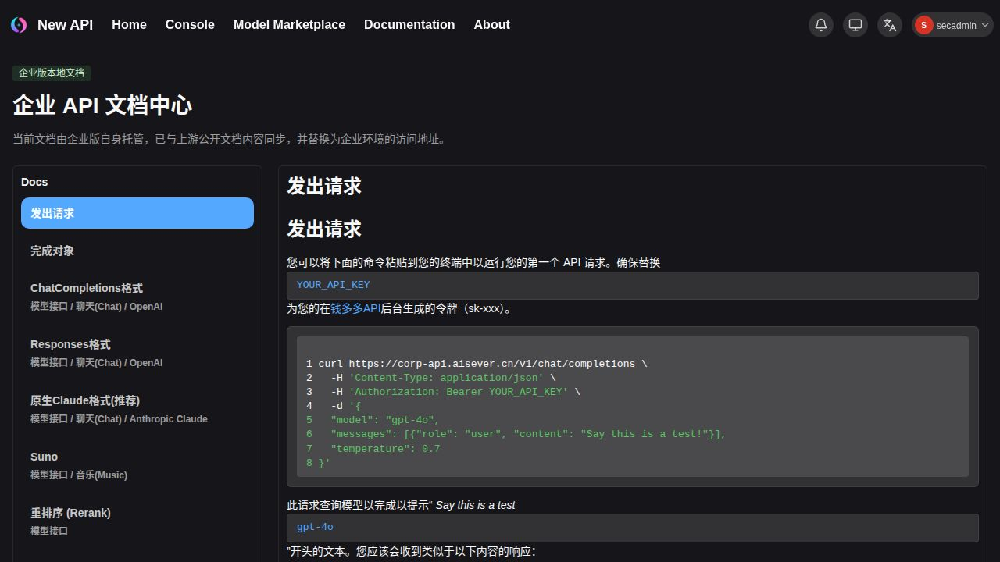

# 安全维护验证结果（2026-10-18）

> 后续状态：用户另行批准生产发布，2026-10-19 已执行同一不可变镜像的发布；最终状态见 [生产发布报告](../../releases/security-20261018/RESULTS.md)。下文“未发布”描述保留为 10 月 18 日候选验收时点的历史记录。

结论：已完成生产基线上的隔离安全维护候选、本地验证和生产主机新建 Docker 测试栈验证。生产服务没有切换，生产数据库、Redis、Caddy、现有应用和旧测试容器均未被修改/重启。本次测试使用独立合成数据；未修改 fhy 或订阅 131。

- 分支：`codex/security-v0.13.2-p1-20261018`
- 起点：`bc32807fcaf6baa118db79cd21996b9b7e4aaca2`
- 候选应用源码：`ba844d202b683219dadc679af3521dc1d8abde9f`（安全回补 `f87c3ba26`，随后修正请求校验 HTTP 状态码）。其后提交仅包含测试辅助和报告，不改变候选应用代码。
- 运行版本：`codex/sec-v0.13.2-p1+ba844d202+test`。版本字符串按现有 setup 表 varchar(50) 约束缩短；完整分支与源码提交保留在回执。
- 镜像：`new-api:security-ba844d202`
- 镜像 ID：`sha256:d07e5682b016202338524f832d8206f2d99ac4b916a1391db92100cdfb9405e1`
- 镜像包 SHA-256：`6e1c7e3f74f694f8d59e357fb823383eb3877fdf401636719ab3eb5a64b4b172`
- 本地可恢复镜像包：`/home/ctyun/Works/new-api/.env/artifacts/security-maintenance-20261018/images-ba844d202.tar.gz`，74,716,669 字节。对应清单为同目录 artifact-manifest.json。
- Go 二进制的 VCS 信息为上述完整候选 SHA，`vcs.modified=false`，Linux/amd64、CGO_ENABLED=0、Go 1.27.2。前端使用 Bun 1.4.3 构建。

## 验证与证据

| 验证层次 | 结果 | 回执 |
|---|---|---|
| Go 全量测试 | 20 个有测试的包通过，其他包编译通过 | [go-tests.log](evidence/go-tests.log) |
| 前端回归与补丁测试 | 45 项通过 | [web-tests.log](evidence/web-tests.log) |
| 前端生产构建 | 通过；保留体积与循环分块警告，实际浏览器页面已验证 | [web-build.log](evidence/web-build.log) |
| SQLite、PostgreSQL、MySQL | 三种实际数据库均验证迁移、扣费后设置更新保留额度、订阅生效分组、零点重置与结算 | [database-contracts.log](evidence/database-contracts.log) |
| Redis 并发与 Go race 检查 | 100 次扣费、旧快照更新、冷缓存初始化并发后额度未恢复，状态禁用保留 | [redis-race.log](evidence/redis-race.log) |
| 原有运维脚本 | 17 项离线回归通过；为缺失的 sshpass 提供拒绝执行的测试占位，不安装系统软件 | [ops-tests.json](evidence/ops-tests.json) |
| 本地候选容器实际 HTTP | 11 项通过 | [local-http.json](evidence/local-http.json) |
| 生产主机隔离栈实际 HTTP | 同一镜像、11 项通过 | [stage-http.json](evidence/stage-http.json) |
| 旧生产镜像回滚兼容性 | 在新测试数据库中启动、schema 指纹不变、余额/订阅锚点不变、登录与合成聊天实际扣费通过 | [stage-rollback.json](evidence/stage-rollback.json) |
| 原生产 5 个容器 | 整个测试窗口 ID、镜像、启动时间、重启计数、运行状态一致；生产状态接口仍为 bc32807fc | [stage-stop.json](evidence/stage-stop.json) |
| 候选镜像来源 | 本地/远端镜像 ID 完全相同；应用仅发布到 127.0.0.1:13018 | [stage-deploy.json](evidence/stage-deploy.json)、[artifact-manifest.json](evidence/artifact-manifest.json) |

11 项 HTTP 验收包括：企业文档 manifest、正常聊天及钱包扣费、SSE、溢出参数 HTTP 400 且额度不变、五个匿名支付入口请求体 HTTP 413、私有 billing/charge 数量乘法、并发设置更新与扣费、管理用户列表隐藏 access_token、显式零参数透传、订阅仅扣订阅额度且按北京时间 00:00 重置、重启后钱包/配置持久化。

首次实际 HTTP 验收发现旧分支将参数校验错误返回 500，已修成 400 并补控制器测试；最终验收使用严格 400 断言。测试配置另修正了过长版本字符串、缓存同步时机及测试令牌长度，最终回执均来自完整通过的重跑。

浏览器验证了首页、登录、控制台、订阅管理、用户列表与邀请比例、帮助页、本地企业文档正文和目录。使用合成账号，真实浏览器可见内容已保存：

## 定制功能保留

维护分支由生产提交直接派生，未删除原有定制文件；48 个定制提交记录在 [custom-baseline-commits.txt](custom-baseline-commits.txt)。验证覆盖按用户邀请奖励比例（含继承与零值）、固定/比例奖励、管理员充值奖励、订阅订单奖励幂等、订阅兑换码、分组限制、私有 billing/charge 与数量、任务价格补丁和退款、用户额度安全编辑、双模式分组倍率编辑器、帮助卡片/品牌、本地企业文档以及原有备份/导入/恢复/部署入口。

完整公告映射见 [advisories.json](advisories.json)，修复来源、适配方式和发布步骤见 [README.md](README.md)。上游新账户体系及 v1 前端没有迁移，不能将本候选描述为 rc.45 全量升级。

## 扫描结果与未验证边界

- Go：可达漏洞 **0**，导入包漏洞 **0**。仅模块级仍有未被导入的旧 OpenPGP 包公告 GO-2026-5932，上游没有修复版本；见 [govulncheck.txt](evidence/govulncheck.txt)。
- Bun 原始扫描仍报告 **1 条**：braces GHSA-vfj7-8cjw-p6xm。已使用可复现的本地原生补丁；同样 50000 层 AST 在原版触发 RangeError，在补丁版正确返回；1728 个普通语法/选项对比相同。见 [bun-audit.json](evidence/bun-audit.json)、[braces-patch-verification.json](evidence/braces-patch-verification.json)。不能称为原始依赖扫描零公告。node_modules 不进入生产运行镜像。
- 实际接口使用合成上游。真实模型/视频提供商、支付沙箱、外部 OAuth、实体 WebAuthn 设备没有端到端验收。未执行容器 OS 漏洞扫描或全部旧版本数据库组合（专项使用 PostgreSQL 16、MySQL 8、SQLite；MySQL 5.7/PostgreSQL 9.6 仅维持现有兼容代码约束）。
- 测试模拟已到期的北京时间零点锚点，未等待自然跨午夜。生产发布后仍应观察实际零点调度。
- 主 Dockerfile 的完整多阶段构建未另行执行；已验证的候选使用完整本地前端/Go 构建和 ops/docker/Dockerfile.security-runtime 组装。同一产物已在本地及远端运行。

## 资源与发布状态

远端本次新建 app/postgres/redis/fixture 及额外 rollback 容器均已停止，目录、数据库、镜像和回执保留在 `~/.local/state/new-api-security-tests/20261018/`；原 `new-api-test` 保持原状。本地七个本次测试容器也已停止并保留数据。维护分支保留供审阅，未推送或执行正式生产发布。

建议采用此维护候选进入发布审核。正式发布须另获明确授权，并按 README 的备份恢复验证、应用单独替换、小额真实业务验收、30–60 分钟观察和跨午夜检查执行。仅在独立测试数据库中验证了旧镜像回滚，不应据此直接回灌生产旧备份或丢弃发布后的交易。
